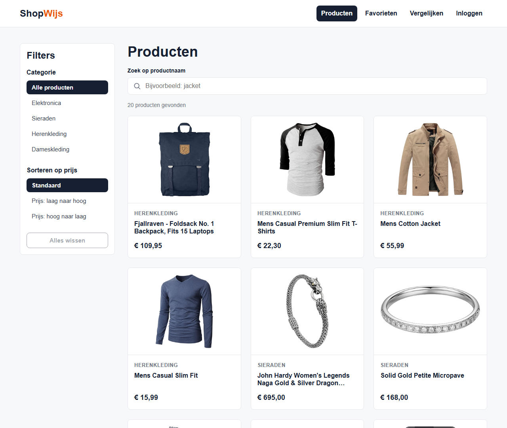

# ShopWijs

## 1. Inleiding

ShopWijs is een React-webapplicatie waarmee gebruikers snel het juiste product vinden in een overzichtelijke productcatalogus. Bezoekers kunnen producten bekijken, zoeken, filteren, sorteren en vergelijken. Ingelogde gebruikers bewaren producten in een persoonlijke favorietenlijst.

Dit project is gemaakt voor de Frontend-eindopdracht van NOVI Hogeschool. De productgegevens komen uit de [Fake Store API](https://fakestoreapi.com). Gebruikersaccounts en favorieten worden opgeslagen in de NOVI Dynamic API.

ShopWijs heeft vier kernfunctionaliteiten:

1. **Registreren en inloggen**: bezoekers maken een account aan en loggen in via de NOVI Dynamic API. Na het inloggen is de beveiligde favorietenpagina beschikbaar. Uitloggen kan via de navigatie.
2. **Producten zoeken, filteren en sorteren**: op de productenpagina zoek je op productnaam, filter je op categorie en sorteer je op prijs (laag naar hoog of hoog naar laag). Deze keuzes werken tegelijk.
3. **Favorieten**: ingelogde gebruikers voegen producten toe aan hun favorieten, bekijken hun eigen favorietenlijst en verwijderen producten daaruit.
4. **Twee producten vergelijken**: met twee keuzelijsten kies je twee producten. Daarna vergelijk je afbeelding, titel, prijs, categorie, beoordeling en beschrijving naast elkaar.

## 2. Inhoudsopgave

1. [Inleiding](#1-inleiding)
2. [Inhoudsopgave](#2-inhoudsopgave)
3. [Screenshot](#3-screenshot)
4. [Benodigdheden](#4-benodigdheden)
   - [Gebruikte technieken](#gebruikte-technieken)
5. [Installatie en configuratie](#5-installatie-en-configuratie)
   - [Stap 1: Project downloaden of klonen](#stap-1-project-downloaden-of-klonen)
   - [Stap 2: Afhankelijkheden installeren](#stap-2-afhankelijkheden-installeren)
   - [Stap 3: Het .env-bestand instellen](#stap-3-het-env-bestand-instellen)
   - [Stap 4: De applicatie starten](#stap-4-de-applicatie-starten)
6. [Overige npm-commando's](#6-overige-npm-commandos)
7. [Testgebruikers](#7-testgebruikers)
8. [Werking van de applicatie](#8-werking-van-de-applicatie)
   - [Pagina's](#paginas)
   - [Zoeken, filteren en sorteren](#zoeken-filteren-en-sorteren)
   - [Producten vergelijken](#producten-vergelijken)
   - [Registreren en inloggen](#registreren-en-inloggen)
   - [Favorieten](#favorieten)
9. [Projectstructuur](#9-projectstructuur)

## 3. Screenshot



*De productenpagina: links de filters voor categorie en sorteren op prijs, rechts de zoekbalk en het productoverzicht.*

## 4. Benodigdheden

Om ShopWijs lokaal te draaien heb je het volgende nodig:

- **Node.js**: versie 20.19 of hoger binnen 20.x, versie 22.13 of hoger binnen 22.x, of versie 24 of hoger. Deze eisen komen uit Vite 8 en ESLint 10. ShopWijs is getest met Node.js 24.11. Controleer je versie met `node --version`.
- **npm**: wordt automatisch met Node.js geïnstalleerd. ShopWijs is getest met npm 11.6. Controleer je versie met `npm --version`.
- **Een internetverbinding**: de productgegevens komen uit de Fake Store API en de accounts en favorieten uit de NOVI Dynamic API.
- **Het `.env`-bestand met het project-ID van de NOVI Dynamic API**: dit bestand wordt afzonderlijk bij de inlevering meegeleverd (zie [stap 3](#stap-3-het-env-bestand-instellen)).
- **Een moderne webbrowser**, zoals Chrome, Edge of Firefox.

### Gebruikte technieken

| Techniek | Versie | Waarvoor |
| -------- | ------ | -------- |
| [React](https://react.dev) | 19 | Gebruikersinterface met functionele componenten en Hooks |
| JavaScript | – | Programmeertaal (geen TypeScript) |
| [React Router](https://reactrouter.com) | 7 | Navigatie, de dynamische route `/producten/:id` en de beveiligde favorietenpagina |
| React Context | – | Gedeelde inlogstatus en favorieten |
| [Vite](https://vite.dev) | 8 | Ontwikkelserver en productiebuild |
| CSS met Flexbox | – | Zelfgeschreven styling, met een eigen CSS-bestand per component en pagina; geen CSS-framework |
| [ESLint](https://eslint.org) | 10 | Controle van de code |
| [Fake Store API](https://fakestoreapi.com/docs) | – | Producten en categorieën |
| NOVI Dynamic API | – | Registreren, inloggen (JWT) en favorieten |

## 5. Installatie en configuratie

### Stap 1: Project downloaden of klonen

Pak het meegeleverde ZIP-bestand uit, of kloon de repository van GitHub:

```bash
git clone https://github.com/adonis070/ShopWijs.git
```

Open daarna een terminal in de projectmap: de map waarin `package.json` staat. Na het klonen is dat:

```bash
cd ShopWijs
```

### Stap 2: Afhankelijkheden installeren

Installeer de benodigde pakketten (onder andere React, React Router, Vite en ESLint):

```bash
npm install
```

npm maakt hiervoor de map `node_modules` aan. Dit hoeft alleen de eerste keer.

### Stap 3: Het .env-bestand instellen

ShopWijs leest zijn configuratie uit een `.env`-bestand in de hoofdmap van het project. Dit bestand staat niet in de repository, omdat het persoonlijke configuratie bevat.

- **Bij de inlevering** wordt het ingevulde `.env`-bestand afzonderlijk meegeleverd. Plaats het in de hoofdmap van het project, naast `package.json`. Je hoeft zelf geen project-ID of API-sleutel aan te maken.
- **Zonder meegeleverd bestand** maak je het `.env`-bestand aan op basis van het voorbeeldbestand en vul je de waarden in:

  ```bash
  cp .env.example .env
  ```

  Op Windows (PowerShell): `Copy-Item .env.example .env`

Het `.env`-bestand bevat de volgende omgevingsvariabelen:

| Variabele | Verplicht | Waarde |
| --------- | --------- | ------ |
| `VITE_FAKESTORE_API_URL` | Nee* | `https://fakestoreapi.com` |
| `VITE_NOVI_API_URL` | Nee* | `https://novi-backend-api-wgsgz.ondigitalocean.app` |
| `VITE_NOVI_PROJECT_ID` | Ja | Het project-ID van de NOVI Dynamic API |

\* Zonder waarde gebruikt ShopWijs automatisch de standaard-URL uit deze tabel.

Een ingevuld `.env`-bestand ziet er zo uit (vervang de placeholder door het echte project-ID):

```env
VITE_FAKESTORE_API_URL=https://fakestoreapi.com
VITE_NOVI_API_URL=https://novi-backend-api-wgsgz.ondigitalocean.app
VITE_NOVI_PROJECT_ID=<jouw-novi-project-id>
```

Let op:

- Zonder project-ID werken registreren, inloggen en favorieten niet. ShopWijs toont dan de melding *"De verbinding met de NOVI API is niet ingesteld: het project-ID ontbreekt in het .env-bestand."*
- Vite leest het `.env`-bestand alleen bij het starten. Herstart de ontwikkelserver nadat je het bestand hebt aangepast.
- Zet het `.env`-bestand nooit in Git. Het staat daarom in `.gitignore`.

**Configuratiebestand van de NOVI Dynamic API.** Het JSON-configuratiebestand (`ShopWijs.json`) wordt eveneens afzonderlijk bij de inlevering meegeleverd. Het beschrijft de collectie `favorites` met de velden `id`, `userId` en `productId`, die alleen toegankelijk is voor gebruikers met de rol `user`. Het NOVI-project dat bij het meegeleverde project-ID hoort, is al met dit bestand ingericht. Je hoeft het bestand alleen te uploaden als je een eigen NOVI-project wilt inrichten.

### Stap 4: De applicatie starten

Start de ontwikkelserver:

```bash
npm run dev
```

Open daarna [http://localhost:5173](http://localhost:5173) in je browser. Je stopt de ontwikkelserver met `Ctrl + C` in de terminal.

ShopWijs draait vast op poort 5173, omdat de NOVI Dynamic API alleen requests vanaf `http://localhost:5173` (of poort 3000) accepteert (CORS). Is poort 5173 al in gebruik, bijvoorbeeld door een andere ontwikkelserver, dan stopt Vite met een foutmelding. Sluit dan eerst het andere programma af en start opnieuw.

## 6. Overige npm-commando's

| Commando | Omschrijving |
| -------- | ------------ |
| `npm run dev` | Start de ontwikkelserver op [http://localhost:5173](http://localhost:5173) |
| `npm run build` | Maakt een geoptimaliseerde productiebuild in de map `dist` |
| `npm run preview` | Toont de productiebuild uit `dist` lokaal op [http://localhost:4173](http://localhost:4173). Voer eerst `npm run build` uit. |
| `npm run lint` | Controleert de code met ESLint op fouten en afwijkingen van de codeerregels |

**Let op bij `npm run preview`:** op poort 4173 blokkeert de NOVI Dynamic API de requests (CORS). Registreren, inloggen en favorieten werken daar dus niet. Wil je de productiebuild volledig testen, stop dan eerst de ontwikkelserver en start de preview op poort 5173:

```bash
npm run preview -- --port 5173
```

## 7. Testgebruikers

Voor de functionaliteiten van ingelogde gebruikers, zoals favorieten, heb je een account nodig. Er zijn twee mogelijkheden:

1. **Meegeleverd testaccount**: de inloggegevens van een testaccount worden afzonderlijk bij de inlevering verstrekt. Om veiligheidsredenen staan ze niet in deze openbare README.
2. **Zelf een testaccount registreren**: kies op de pagina **Inloggen** het tabblad **Registreren**. Vul een fictief e-mailadres in (bijvoorbeeld `tester@example.com`) en een wachtwoord van minimaal 6 tekens. Log daarna in op het tabblad **Inloggen**.

Gebruik alleen testgegevens, geen echte persoonsgegevens. De NOVI Dynamic API is een leeromgeving die dagelijks wordt geleegd. Een zelf geregistreerd account kan daardoor na een dag verdwenen zijn; registreer in dat geval opnieuw.

Zo test je de functionaliteiten voor ingelogde gebruikers:

1. Log in. De navigatie toont nu je e-mailadres en de knop **Uitloggen**.
2. Open een product en kies **Toevoegen aan favorieten**. Het hart wordt gevuld en je krijgt een bevestiging.
3. Ga naar **Favorieten** om je bewaarde producten te bekijken en kies **Verwijderen** om een product uit de lijst te halen.
4. Log in met een tweede testaccount: elke gebruiker ziet alleen zijn eigen favorieten.

## 8. Werking van de applicatie

### Pagina's

| Route | Pagina |
| ----- | ------ |
| `/` | Homepage met uitgelichte producten en categorieknoppen |
| `/producten` | Productoverzicht met zoeken, filteren en sorteren |
| `/producten/:id` | Productdetailpagina met de favorietenknop |
| `/favorieten` | Favorietenpagina (alleen voor ingelogde gebruikers) |
| `/inloggen` | Inlog- en registratiepagina |
| `/vergelijken` | Productvergelijking |

Een onbekende route toont de pagina *Pagina niet gevonden*.

### Zoeken, filteren en sorteren

Op de pagina `/producten` kun je:

- zoeken op productnaam (direct tijdens het typen, hoofdletterongevoelig);
- filteren op categorie;
- sorteren op prijs, van laag naar hoog of van hoog naar laag.

Deze keuzes werken tegelijk. De gekozen categorie en sortering staan in de URL, bijvoorbeeld `/producten?categorie=electronics&sortering=prijs-oplopend`. Daardoor openen de categorieknoppen op de homepage direct een gefilterd overzicht. Met de knop **Alles wissen** zet je alle keuzes in één keer terug.

### Producten vergelijken

Op de pagina `/vergelijken` kies je met twee keuzelijsten twee producten. Na een klik op **Vergelijken** staan afbeelding, titel, prijs, categorie, beoordeling en beschrijving naast elkaar in een tabel. De laagste prijs en de hoogste beoordeling krijgen een groen label.

- Een gekozen product vervang je via de keuzelijst; de vergelijking werkt direct bij.
- Het product dat in de andere keuzelijst is gekozen, kun je niet nog eens kiezen.
- Met minder dan twee gekozen producten verschijnt de melding om twee producten te selecteren.

Voor de vergelijking is geen account nodig.

### Registreren en inloggen

Op de pagina `/inloggen` staan twee tabbladen:

- **Registreren** maakt een account aan via `POST /api/users` van de NOVI Dynamic API. Nieuwe accounts krijgen de rol `user`.
- **Inloggen** gebruikt `POST /api/login`. De API geeft een JWT-token terug, die een uur geldig is.

De inlogstatus staat in een React Context (`AuthProvider`) en blijft bewaard in `localStorage`, zodat je ingelogd blijft na het herladen van de pagina. Verloopt de token, dan word je automatisch uitgelogd. Uitloggen verwijdert alleen de token; daarvoor is geen API-aanroep nodig.

De favorietenpagina is beveiligd. Ben je niet ingelogd, dan ga je eerst naar het inlogformulier en daarna terug naar de pagina die je wilde bekijken.

### Favorieten

Ingelogde gebruikers bewaren producten met de knop **Toevoegen aan favorieten** op de productdetailpagina. Een bewaard product toont een gevuld hart. Op de pagina `/favorieten` staan de eigen favorieten, met een knop om ze te verwijderen.

De favorieten staan in de NOVI-collectie `favorites` met de velden `id`, `userId` en `productId`:

| Actie | Request |
| ----- | ------- |
| Eigen favorieten ophalen | `GET /api/users/{userId}/favorites` |
| Toevoegen | `POST /api/favorites` met `{ "userId": 1, "productId": 5 }` |
| Verwijderen | `DELETE /api/favorites/{id}` |

Alle requests sturen de JWT-token mee (`Authorization: Bearer ...`). Het gebruikers-ID komt uit de claim `userId` van die token. Een product dat al bewaard is, wordt niet nog eens toegevoegd. Afbeelding, titel en prijs van de producten komen uit de Fake Store API.

Elke request naar de NOVI API stuurt bovendien de header `novi-education-project-id` mee met het project-ID uit het `.env`-bestand.

## 9. Projectstructuur

```
shopwijs/
├── docs/
│   └── screenshots/  Screenshot voor deze README
├── public/           Statische bestanden (favicon)
├── src/
│   ├── components/   Herbruikbare componenten (Navbar, ProductCard, FilterGroup, ...)
│   ├── context/      React Context voor inlogstatus en favorieten (AuthProvider, FavoritesProvider)
│   ├── pages/        Pagina's die aan een route gekoppeld zijn
│   ├── services/     API-aanroepen naar de Fake Store API en de NOVI Dynamic API
│   ├── styles/       CSS-bestanden per component en pagina
│   ├── utils/        Hulpfuncties (notatie, zoeken, filteren, sorteren, JWT, validatie)
│   ├── App.jsx       Routes en vaste opmaak
│   └── main.jsx      Startpunt van de applicatie
├── .env.example      Voorbeeld van de omgevingsvariabelen
├── index.html        HTML-startpagina
├── package.json      Afhankelijkheden en npm-commando's
└── vite.config.js    Vite-configuratie (vaste poort 5173)
```
